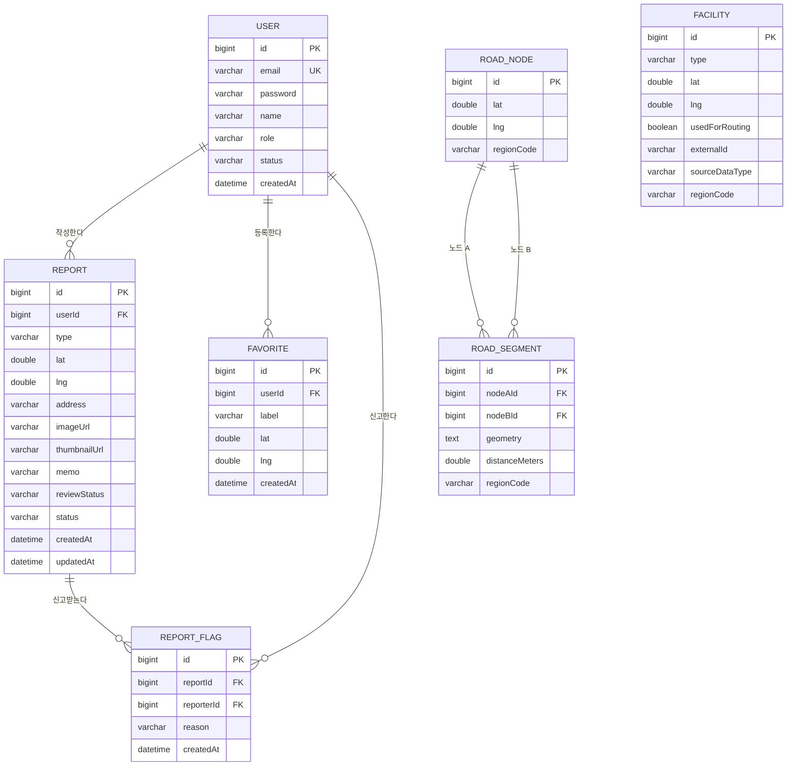

# SAFENAVI (컴퓨터공학종합설계2 개인 졸업작품)

### 목차

- **요구분석**
  - [프로젝트 소개](#프로젝트-소개)
  - [프로젝트 목적](#프로젝트-목적)
  - [문제 정의](#문제-정의)
  - [예상 사용자](#예상-사용자)
  - [기능 요구사항](#기능-요구사항)
  - [비기능 요구사항](#비기능-요구사항)
  - [유스케이스](#유스케이스)
- **설계**
  - [시스템 아키텍처](#시스템-아키텍처)
  - [핵심 알고리즘](#핵심-알고리즘)
  - [데이터베이스 설계(ERD)](#데이터베이스-설계-ERD)
  - [데이터베이스 명세서](#데이터베이스-명세서)
  - [API 설계](#API-설계)
- **구현**
  - [프론트엔드](#프론트엔드)
  - [백엔드](#백엔드)
  - [데이터베이스](#데이터베이스)
- **테스트**
  - [테스트 전략](#테스트-전략)
  - [단위 테스트 결과](#단위-테스트-결과)
  - [통합 테스트 결과](#통합-테스트-결과)
- [설치 및 실행](#설치-및-실행)
- [향후 개선 사항](#향후-개선-사항)
- [결론](#결론)

<br>

---

## 프로젝트 소개

**SAFENAVI**는 CCTV·보안등·지구대파출소·안심지킴이집·응급의료기관 등 공공데이터를 기반으로, 출발지에서 목적지까지 더 안전한 보행 경로를 추천하는 모바일 앱입니다.

사용자는 지도에서 목적지를 탭하는 것만으로 프리셋별(기본안전경로/CCTV 위주/가로등 위주/공공안전시설 위주/안심지킴이집 위주) 경로를 비교해볼 수 있고, 실제로 겪은 위험요소(조명부족, 시야가림 등)를 제보해 공공데이터가 놓친 빈틈을 커뮤니티가 보완합니다.

<br>

---

## 프로젝트 목적

- **개인화된 안전 기준 반영** — 프리셋 선택에 따라 서로 다른 경로를 제공해, "안전"의 기준이 사람마다 다르다는 점을 반영한다.
- **커뮤니티 제보를 통한 위험정보 보완** — 공공데이터가 놓치는 실제 위험요소(조명부족, 시야가림 등)를 시민 제보로 메운다.
- **신뢰성과 역할의 분리** — 경로 탐색은 검증된 공공데이터를 기준으로 하고, 제보는 참고 정보로만 노출해 두 데이터의 신뢰 수준을 명확히 분리한다.

<br>

---

## 문제 정의

| 문제 | 내용 |
|------|------|
| **최단거리 중심 내비게이션** | 기존 지도 앱은 "가장 빠른 길"만 안내할 뿐, 보행자가 느끼는 안전도(조명, CCTV, 치안시설 접근성)는 고려하지 않음 |
| **공공데이터의 파편화** | CCTV·보안등·안심지킴이집 등 안전 관련 공공데이터가 각각 다른 포털에 흩어져 있어, 일반 사용자가 직접 종합해서 판단하기 어려움 |
| **획일적인 안전 기준** | "안전한 길"의 기준은 CCTV를 중시하는 사람, 가로등을 중시하는 사람 등 제각각인데 기존 서비스는 이를 구분하지 않음 |
| **실시간 위험정보 공백** | 공공데이터는 갱신 주기가 길어, 최근 발생한 위험요소(가로등 고장, 시야 가리는 공사 등)를 반영하지 못함 |

<br>

---

### 예상 사용자

| 유형 | 설명 |
|------|------|
| **보행 안전 민감 사용자** | 늦은 시간 귀가·등하교가 잦아 보행 경로의 안전성을 우선순위로 두는 사용자 |
| **지역 커뮤니티 제보자** | 거주 지역의 위험요소(조명부족, 시야가림 등)를 공유하고 다른 보행자에게 알리고 싶은 사용자 |
| **공공데이터 참고 이용자** | 특정 안전 기준(CCTV, 치안시설 등)에 따라 경로를 직접 비교해보고 싶은 사용자 |

<br>

---

## 기능 요구사항

### 인증
- 이메일/비밀번호 기반 회원가입·로그인 (비밀번호 8자 이상, BCrypt 해시, JWT 토큰)
- Access Token(30분) / Refresh Token(2주) 이원화, 토큰 재발급
- 로그인 없이 경로 탐색·지도 조회·제보 조회 가능 (읽기 전용)

### 경로 탐색
- 목적지 확정 시 5개 프리셋(기본안전경로/CCTV 위주/가로등 위주/공공안전시설 위주/안심지킴이집 위주) 소요시간 자동 비교
- 프리셋 선택 시 해당 경로의 polyline을 지도에 표시
- 다익스트라 기반 최소 비용 경로 탐색 (직접 구현, 외부 그래프 라이브러리 미사용)
- 출발·도착 직선거리 20 km 초과 시 탐색 제한

### 지도 기능
- OpenStreetMap 타일 기반 전체화면 지도
- CCTV·보안등·지구대파출소·안심지킴이집·응급의료기관 위치 마커 표시 (유형별 필터)
- 제보 위치 마커(사진 썸네일, 미처리 상태 표시) 및 상세 확인
- 특정 좌표의 안전점수 조회

### 즐겨찾기
- 자주 가는 목적지 등록·조회·삭제 (집/학교 등 라벨 지정, 본인 것만 조회·삭제)

### 커뮤니티 제보
- 위험요소 제보 등록 (유형: 조명부족/시야가림/기타, 사진 첨부, 위치 자동 감지, 주소 변환 실패 시 주소 없이 저장)
- 본인 제보 수정·삭제, 허위 제보 신고 (본인 제보 신고·중복 신고 차단)
- 제보 상태(접수됨/검토중/반영됨) 확인

### 관리자
- 신고 누적 제보 검토 후 유지(KEEP) 또는 제거(REMOVED, 소프트 삭제) 처리
- 사용자 계정 상태(활성/정지) 관리, 정지된 사용자의 제보 등록 제한
- 공공데이터 수동 동기화

### 실시간 알림
- 제보 등록 시 해당 지역 구독자에게 WebSocket(STOMP)으로 실시간 알림

<br>

---

## 비기능 요구사항

| 항목	| 설명 |
|----|-----|
|성능 | 일반 API는 평균 2초 이내, 경로 탐색은 3초 이내 응답 |
|보안 |	비밀번호는 BCrypt 해시 저장, 인증은 JWT(Access/Refresh 이원화) 기반 |
|확장성	| 전국 서비스를 전제로 지역코드(regionCode) 기준 파티셔닝·병렬 배치가 가능한 구조로 설계 |
|가용성 | 공공데이터 API가 장애여도 기존 데이터를 유지하고 오류를 기록 |
|호환성	| iOS·Android 양쪽에서 동작하는 React Native(Expo) 앱으로 구현 |

<br>

---

## 유스케이스

| 액터 | 주요 유스케이스 |
|------|----------------|
| 비로그인 사용자 | 경로 탐색, 프리셋 비교, 지도·제보 조회 |
| 로그인 사용자 | 위 기능 + 제보 등록/수정/삭제, 허위 제보 신고, 즐겨찾기 관리, 실시간 알림 수신 |
| 관리자 | 신고된 제보 검토·처리, 사용자 계정 관리, 공공데이터 수동 동기화 |

<br>

---

## 시스템 아키텍처

```
[React Native(Expo) 앱]
        │  REST API / WebSocket(STOMP)
        ▼
[Spring Boot 백엔드 (내장 Tomcat, EC2, Docker)]
        │   Spring Security(JWT 필터) → DispatcherServlet → Controller → Service → Repository
        │
        ├─ MySQL 8.0 (AWS RDS) — User/RoadNode/RoadSegment/Facility/Report/ReportFlag/Favorite
        ├─ Redis — 캐싱 (향후 로그아웃 블랙리스트 등)
        ├─ AWS S3 — 제보 사진 저장
        ├─ OpenStreetMap 타일 — 지도 렌더링
        └─ 외부 연동
             ├─ 공공데이터포털 API (CCTV·보안등·안심지킴이집·응급의료기관) + 지구대파출소 파일 — 매일 새벽 스케줄러
             ├─ OSM Nominatim — 역지오코딩
             └─ OSM .pbf + 시군구 경계 Shapefile — 그래프 구축(graphbuild, 1회성 배치)
```

Spring Boot의 내장 Tomcat이 HTTP 요청을 받아 스레드 풀의 스레드 하나에 배정하고, 인증 필터와 `DispatcherServlet`을 거쳐 컨트롤러에서 DB까지 처리한 뒤 JSON으로 응답합니다. Cloudflare를 통해 HTTPS로 서비스하며, GitHub Actions + CodeDeploy로 CI/CD를 구성합니다.

<br>

---

## 핵심 알고리즘

전국 도로망을 미리 계산해 저장하지 않고, **출발지~목적지 주변의 도로망·공공시설 데이터만 요청 시점에 불러와 계산**합니다. 구간(간선) 비용은 다익스트라가 구간을 처음 만나는 순간 계산하고 캐시합니다.

### 처리 순서

1. 출발·도착 직선거리가 20 km 이하인지 확인
2. **도로 박스** = 두 점 ± 500 m → 박스 안의 RoadNode·RoadSegment로 서브그래프(인접 리스트) 구성
3. 출발·도착 좌표를 가장 가까운 노드에 스냅 (한도 1 km)
4. **시설 박스** = 도로 박스 ± 1,000 m (가장 큰 영향 반경인 응급의료 1,000 m) → 박스 안 시설을 쿼리 1번으로 불러와 STR-tree에 적재
5. 5개 프리셋(cctv → streetlight → guardianHouse → publicSafety → default)마다 다익스트라 실행
   - 구간을 처음 만나면 STR-tree에서 유형별 반경 안 시설을 집계해 유형 점수 → 안전 점수 → 구간 비용을 계산하고 캐시
   - 유형별 점수는 구간당 한 번만 계산해 5개 프리셋이 공유
6. 도착 노드를 큐에서 꺼내면 종료, 경로를 복원해 polyline·거리·예상 시간·안전점수 계산

### 구간 비용

```
유형 점수(0~1) = 구간 꺾은선 전체에서 반경 r 이내의 시설 수를, 구간 길이에 맞춘 기대 개수와 비교
안전 점수      = Σ(프리셋 가중치 × 유형 점수)
구간 비용      = 거리 × (1 + 위험 페널티)        // 위험 페널티는 안전할수록 작아짐
```

시설은 비용을 더하는 가중치가 아니라 **실제 거리에 곱하는 배율을 낮추는 역할**을 합니다. 주변에 안전시설이 없는 도로는 거리 × 2.0(최대 페널티)이고, 시설이 늘수록 비용이 감소합니다. 비용이 항상 0 이상이므로 다익스트라를 쓸 수 있습니다.

### 시설 유형별 집계 반경

| 유형 | 반경 |
|------|------|
| CCTV | 50 m |
| 가로등(보안등) | 30 m |
| 안심지킴이집 | 150 m |
| 경찰(지구대·파출소) | 500 m |
| 응급의료기관 | 1,000 m |

반경 판정은 노드나 굴곡점이 아니라 **구간 꺾은선 전체**를 기준으로 합니다.

### 프리셋 가중치

| 프리셋 | CCTV | 가로등 | 안심지킴이집 | 경찰 | 응급의료 |
|---|---|---|---|---|---|
| cctv | 1.0 | – | – | – | – |
| streetlight | – | 1.0 | – | – | – |
| guardianHouse | – | – | 1.0 | – | – |
| publicSafety | – | – | – | 0.5 | 0.5 |
| default | 0.25 | 0.25 | 0.25 | 0.125 | 0.125 |

응답의 `safetyScore`(0~100)는 선택한 프리셋과 무관하게 항상 default 가중치로, 경로 구간 길이를 가중해 계산합니다. 경로를 **고를 때**는 프리셋 가중치를, 점수를 **보여줄 때**는 default 가중치를 씁니다.

<br>

---

## 데이터베이스 설계 ERD



`Facility`는 어떤 테이블과도 FK로 연결되지 않습니다. 구간과 시설의 관계는 저장하지 않고, 요청 시점에 공간 조회(bbox)와 STR-tree 검색으로 계산합니다.

<br>

---

## 데이터베이스 명세서

### User 테이블

| 컬럼 | 타입 | NULL | KEY | 기본값 | 설명 |
|------|------|------|-----|--------|------|
| id | BIGINT | NOT NULL | PK | AUTO_INCREMENT | 사용자 고유 ID |
| email | VARCHAR(255) | NOT NULL | UNIQUE | - | 로그인 이메일 |
| password | VARCHAR(255) | NOT NULL | - | - | BCrypt 해시 |
| name | VARCHAR(50) | NOT NULL | - | - | 이름 |
| role | VARCHAR(20) | NOT NULL | - | USER | USER \| ADMIN |
| status | VARCHAR(20) | NOT NULL | - | ACTIVE | ACTIVE \| SUSPENDED |
| createdAt | DATETIME | NOT NULL | - | CURRENT_TIMESTAMP | 가입 시각 |

### RoadNode 테이블

| 컬럼 | 타입 | NULL | KEY | 설명 |
|------|------|------|-----|------|
| id | BIGINT | NOT NULL | PK | 교차로 식별자 |
| lat / lng | DOUBLE | NOT NULL | - | 좌표 |
| regionCode | VARCHAR(10) | NOT NULL | - | 시군구 코드 (파티셔닝 기준) |

### RoadSegment 테이블

| 컬럼 | 타입 | NULL | KEY | 설명 |
|------|------|------|-----|------|
| id | BIGINT | NOT NULL | PK | 간선 식별자 |
| nodeAId / nodeBId | BIGINT | NOT NULL | FK (→ RoadNode) | 양 끝점 (무방향 그래프, 방향 의미 없음) |
| geometry | TEXT | NOT NULL | - | 폴리라인 좌표열 (시작 교차로, 중간 좌표점, 끝 교차로) |
| distanceMeters | DOUBLE | NOT NULL | - | 기본 거리(m) |
| regionCode | VARCHAR(10) | NOT NULL | - | 시군구 코드 |

### Facility 테이블

| 컬럼 | 타입 | NULL | KEY | 설명 |
|------|------|------|-----|------|
| id | BIGINT | NOT NULL | PK | 시설 식별자 |
| type | VARCHAR(30) | NOT NULL | - | cctv\|streetlight\|police\|guardianHouse\|emergencyMedical |
| lat / lng | DOUBLE | NOT NULL | - | 좌표 |
| usedForRouting | BOOLEAN | NOT NULL | - | 경로 가중치 반영 여부 (기본 true, 동기화해도 관리자 설정 유지) |
| externalId | VARCHAR(100) | NULL | UNIQUE | 공공데이터 원본 식별자 (중복 수집 방지) |
| sourceDataType | VARCHAR(30) | NOT NULL | - | 데이터 출처 종류 |
| regionCode | VARCHAR(10) | NOT NULL | - | 시군구 코드 |

### Report 테이블

| 컬럼 | 타입 | NULL | KEY | 설명 |
|------|------|------|-----|------|
| id | BIGINT | NOT NULL | PK | 제보 식별자 |
| userId | BIGINT | NOT NULL | FK (→ User) | 작성자 |
| type | VARCHAR(20) | NOT NULL | - | 조명부족\|시야가림\|기타 |
| lat / lng | DOUBLE | NOT NULL | - | 제보 위치 |
| address | VARCHAR(255) | NULL | - | 역지오코딩 주소 (변환 실패 시 null) |
| imageUrl / thumbnailUrl | VARCHAR(500) | NULL | - | 원본/축소 이미지(S3) |
| memo | VARCHAR(500) | NULL | - | 메모 |
| reviewStatus | VARCHAR(20) | NOT NULL | - | 접수됨\|검토중\|반영됨 (제보자가 보는 진행 상태) |
| status | VARCHAR(20) | NOT NULL | - | ACTIVE\|REMOVED (관리자 소프트 삭제) |
| createdAt / updatedAt | DATETIME | - | - | 등록/수정 시각 |

### ReportFlag 테이블

| 컬럼 | 타입 | NULL | KEY | 설명 |
|------|------|------|-----|------|
| id | BIGINT | NOT NULL | PK | 신고 식별자 |
| reportId | BIGINT | NOT NULL | FK (→ Report) | 신고 대상 제보 |
| reporterId | BIGINT | NOT NULL | FK (→ User) | 신고자 |
| reason | VARCHAR(255) | NOT NULL | - | 신고 사유 |
| createdAt | DATETIME | NOT NULL | - | 신고 시각 |

### Favorite 테이블

| 컬럼 | 타입 | NULL | KEY | 설명 |
|------|------|------|-----|------|
| id | BIGINT | NOT NULL | PK | 즐겨찾기 식별자 |
| userId | BIGINT | NOT NULL | FK (→ User) | 소유자 |
| label | VARCHAR(50) | NOT NULL | - | 집/학교 등 지정 이름 |
| lat / lng | DOUBLE | NOT NULL | - | 좌표 |
| createdAt | DATETIME | NOT NULL | - | 등록 시각 |

<br>

---

## API 설계

```
Authorization: Bearer <JWT_TOKEN>
```

Base URL: `https://api.safenavi.app/api` (버전 세그먼트 없음) — 모든 응답은 `{ success, data, error }` 공통 래퍼를 사용합니다.

### 엔드포인트 목록

| 도메인 | Method | Endpoint | 설명 | 인증 |
|---|---|---|---|---|
| 인증 | POST | /api/auth/signup | 회원가입 | 불필요 |
| | POST | /api/auth/login | 로그인, JWT 발급 | 불필요 |
| | POST | /api/auth/logout | 로그아웃 | 필요 |
| | POST | /api/auth/token/refresh | Access Token 재발급 | 불필요 |
| 사용자 | GET | /api/users/me | 내 프로필 | 필요 |
| 위치 | GET | /api/geo/reverse | 좌표 → 동 이름·도로명 주소 | 불필요 |
| 경로 | GET | /api/routes | 프리셋 1개의 경로 (polyline 포함) | 불필요 |
| | GET | /api/routes/compare | 5개 프리셋 요약 (polyline 없음) | 불필요 |
| 안전점수 | GET | /api/safety-score | 좌표·반경의 안전점수와 시설 개수 | 불필요 |
| 즐겨찾기 | POST | /api/favorites | 등록 | 필요 |
| | GET | /api/favorites | 내 목록 | 필요 |
| | DELETE | /api/favorites/{favoriteId} | 삭제 (본인만) | 필요 |
| 시설 | GET | /api/facilities | bbox 내 시설 (type 필터) | 불필요 |
| 제보 | POST | /api/reports | 제보 등록 (multipart) | 필요 |
| | GET | /api/reports | bbox 내 목록 (type·status 필터) | 불필요 |
| | GET | /api/reports/{reportId} | 상세 (isOwner 포함) | 불필요 |
| | GET | /api/reports/me | 내 제보 이력 (최신순) | 필요 |
| | PATCH | /api/reports/{reportId} | 수정 (본인만) | 필요 |
| | DELETE | /api/reports/{reportId} | 삭제 (본인만) | 필요 |
| | POST | /api/reports/{reportId}/flags | 허위 제보 신고 | 필요 |
| 관리자 | GET | /api/admin/reports | 신고된 제보 목록 | admin |
| | PATCH | /api/admin/reports/{reportId}/status | KEEP / REMOVED 처리 | admin |
| | GET | /api/admin/users | 사용자 목록 | admin |
| | PATCH | /api/admin/users/{userId}/status | 이용 제한 (ACTIVE/SUSPENDED) | admin |
| | POST | /api/admin/public-data/sync | 공공데이터 수동 동기화 | admin |
| 실시간 | WS | /ws (STOMP) | 연결 | 필요 |
| | SUB | /topic/alerts/{regionId} | 지역 단위 위험 알림 구독 | 필요 |

### 오류 코드

| HTTP | code | 발생 상황 |
|---|---|---|
| 400 | INVALID_INPUT | 입력값 오류 (8자 미만 비밀번호, 없는 제보 유형, 위도 범위 초과 등) |
| 400 | ROUTE_TOO_FAR | 출발·도착 직선거리 20 km 초과 |
| 400 | UNKNOWN_PRESET | 없는 프리셋 |
| 400 | BBOX_TOO_LARGE | 지도 범위가 0.5°를 넘음 |
| 401 | UNAUTHORIZED | 토큰 없이 인증 필요 API 호출 |
| 401 | INVALID_TOKEN | refresh 토큰으로 API 호출, 다른 키로 서명한 토큰 |
| 401 | INVALID_CREDENTIALS | 틀린 비밀번호 |
| 403 | FORBIDDEN | 권한 없음 (타인의 제보·즐겨찾기, 관리자 API) |
| 403 | USER_SUSPENDED | 정지된 사용자의 제보 등록 |
| 404 | NO_ROAD_DATA | 도로 데이터가 없는 지역 |
| 409 | EMAIL_ALREADY_EXISTS | 중복 이메일로 가입 |

---

### 주요 API 상세

#### 회원가입
```
POST /api/auth/signup
```
**Request Body**
```json
{ "email": "user@example.com", "password": "Pa$$w0rd!", "name": "고영민" }
```
**Response 201**
```json
{ "success": true, "data": { "userId": 101, "email": "user@example.com", "name": "고영민" }, "error": null }
```

---

#### 프리셋 비교
```
GET /api/routes/compare?originLat=&originLng=&destLat=&destLng=
```
목적지가 확정되면 자동 호출되며, polyline은 포함하지 않습니다.

**Response 200**
```json
{
  "success": true,
  "data": [
    { "preset": "default", "distanceMeters": 980, "estimatedMinutes": 12, "safetyScore": 55 },
    { "preset": "cctv", "distanceMeters": 1180, "estimatedMinutes": 15, "safetyScore": 82 }
  ],
  "error": null
}
```

---

#### 단일 경로 탐색
```
GET /api/routes?originLat=&originLng=&destLat=&destLng=&preset=cctv
```
`preset`: `default | cctv | streetlight | publicSafety | guardianHouse`

**Response 200**
```json
{
  "success": true,
  "data": {
    "preset": "cctv", "distanceMeters": 1180, "estimatedMinutes": 15,
    "safetyScore": 82, "polyline": [[37.4979, 127.0276], [37.4981, 127.0280]]
  },
  "error": null
}
```

---

#### 지도 범위 내 공공시설 조회
```
GET /api/facilities?swLat=&swLng=&neLat=&neLng=&type=cctv
```
`type`: `cctv | streetlight | police | guardianHouse | emergencyMedical`

---

#### 제보 등록
```
POST /api/reports   (multipart/form-data)
```
```
type: "조명부족"
lat: 37.4979
lng: 127.0276
memo: "가로등이 꺼져있어서 밤에 어두워요"
image: (file)
```
**Response 201** — `reportId`, `type`, `imageUrl`, `createdAt`

---

#### 관리자 — 제보 상태 처리
```
PATCH /api/admin/reports/{reportId}/status
```
```json
{ "status": "REMOVED" }
```
`status`: `KEEP | REMOVED`. 삭제가 아니라 상태 변경(소프트 삭제)이라 기록이 DB에 남고 일반 조회에서만 제외됩니다.

<br>

---

## 프론트엔드

| 분류 | 기술 |
|------|------|
| 프레임워크 | React Native (Expo) |
| 언어 | TypeScript |
| 지도 | react-native-maps + OpenStreetMap 타일 |
| 인증 토큰 저장 | expo-secure-store (Keychain/Keystore) |
| 외부 API | OSM Nominatim (역지오코딩), Kakao Local API (향후 확장) |

---

## 백엔드

| 분류 | 기술 |
|------|------|
| 언어 | Java 17 |
| 프레임워크 | Spring Boot 4.1.1 (내장 Tomcat) |
| 빌드 도구 | Gradle (Groovy DSL) |
| 데이터베이스 | MySQL 8.0 (AWS RDS) |
| ORM | Spring Data JPA |
| 인증 | Spring Security + JWT, BCrypt |
| 실시간 통신 | Spring WebSocket (STOMP) |
| 스케줄링 | `@Scheduled` (공공데이터 매일 동기화) |
| 외부 API 호출 | WebClient |
| OSM 파싱 | osm4j-core, osm4j-pbf |
| 공간 연산 | JTS (STR-tree, 거리 계산) |
| 파일 저장 | AWS S3 SDK v2 |
| 배포 | Docker, EC2, GitHub Actions, CodeDeploy, Cloudflare |

---

## 데이터베이스

| 기술 | 설명 |
|------|------|
| MySQL 8.0 | 관계형 데이터베이스, AWS RDS로 운영 |

### 저장 데이터 설명

| 테이블 | 저장 데이터 |
|--------|------------|
| `User` | 회원 계정 정보 (이메일, 비밀번호 해시, 역할, 상태) |
| `RoadNode` | 도로망 그래프의 교차로 좌표 |
| `RoadSegment` | 교차로 사이 도로 구간(거리·폴리라인), 다익스트라 탐색 대상 |
| `Facility` | CCTV·보안등·지구대파출소·안심지킴이집·응급의료기관 좌표 |
| `Report` | 시민 제보(위험요소 유형, 위치, 사진, 처리 상태) |
| `ReportFlag` | 제보에 대한 허위 신고 이력 |
| `Favorite` | 사용자별 즐겨찾기 목적지 |

<br>

---

## 테스트 전략

계산 로직은 **단위 테스트(화이트박스)**, 전체 흐름은 **통합 테스트(블랙박스)** 로 나누어 검증했습니다.

| 구분 | 단위 테스트 | 통합 테스트 |
|---|---|---|
| 검증 대상 | 구간 비용, 다익스트라, JWT, 도로 분할 등 계산·처리 클래스 하나씩 | 회원가입부터 경로 조회까지 요청 → DB → 응답 전체 흐름 |
| 환경 | DB·Spring 없이 순수 Java | 실제 DB와 연동한 Spring Boot 테스트 |
| 잡아내는 문제 | 식 오류, 경계값, 알고리즘 로직 | 쿼리, 매핑, 인증·인가(401·403·409), 응답 형식 |
| 이유 | 정답을 손으로 구할 수 있고 실패 원인이 한 클래스로 좁혀짐 | 계산이 맞아도 클래스와 DB를 연결했을 때 생기는 문제는 붙여 봐야 드러남 |

단위 테스트로 계산을 먼저 고정한 뒤, 통합 테스트로 전체 흐름을 확인했습니다. 경로 탐색 테스트는 직접 만든 소규모 도로망을 사용해, 프리셋별 기대 경로를 손으로 계산해 단언했습니다.

---

## 단위 테스트 결과

11개 시나리오 모두 Pass.

| 대상 | 테스트 시나리오 | 기대 결과 | 결과값 | Pass 여부 |
|------|----------------|----------|--------|----------|
| Dijkstra | 거쳐 가는 도로 수는 많지만 비용이 더 싼 경로 | 비용 기준 경로 1→3→4 | 1→3→4 | ✅ Pass |
| Dijkstra | 출발지와 도착지가 연결되지 않음 | 빈 결과 (오류 없음) | 빈 결과 | ✅ Pass |
| 도로 비용 계산 | 주변에 안전시설이 없는 도로 | 거리 × 2.0 (최대 페널티) | 거리 × 2.0 | ✅ Pass |
| 도로 비용 계산 | CCTV를 0→5개로 하나씩 늘림 | 비용이 계속 감소 | 매번 감소 | ✅ Pass |
| 도로 비용 계산 | 가로등 10개일 때 가로등·CCTV 프리셋 비교 | 가로등 프리셋 비용이 더 낮음 | 더 낮음 | ✅ Pass |
| JWT | refresh 토큰을 access 토큰으로 사용 | INVALID_TOKEN | INVALID_TOKEN | ✅ Pass |
| JWT | 다른 비밀키로 서명한 토큰 | INVALID_TOKEN | INVALID_TOKEN | ✅ Pass |
| 보행 도로 필터 | 자동차 전용도로 (보행 허용 표시 없음) | 경로에서 제외 | 제외 | ✅ Pass |
| 도로 분할 | 도로 A·B가 노드 3에서 교차 | 1-3, 3-5, 10-3, 3-11 | 1-3, 3-5, 10-3, 3-11 | ✅ Pass |
| 공공데이터 | API가 오류 코드 반환 | 오류로 알림 | "resultCode=10" 오류 | ✅ Pass |
| 주소 → 좌표 | "난곡로64 난우파출소" 같은 비정형 주소 | "난곡로 64"로 정리 | "난곡로 64" | ✅ Pass |

---

## 통합 테스트 결과

45개 시나리오 모두 Pass.

| No | 대상 | 테스트 시나리오 | 기대 결과 | 결과값 | Pass 여부 |
|----|------|----------------|----------|--------|----------|
| 1 | 회원가입 | 회원가입 | 201, USER/ACTIVE, 비밀번호 암호화 | 201, BCrypt 해시 저장 | Pass |
| 2 | 회원가입 | 중복 이메일로 가입 | 409 EMAIL_ALREADY_EXISTS | 409 | Pass |
| 3 | 회원가입 | 8자 미만 비밀번호 | 400 INVALID_INPUT | 400 | Pass |
| 4 | 로그인 | 로그인 → 내 정보 조회 | 토큰 발급, 내 정보 반환 | Bearer 토큰, kim@test.com | Pass |
| 5 | 로그인 | 틀린 비밀번호 | 401 INVALID_CREDENTIALS | 401 | Pass |
| 6 | 로그인 | refresh 토큰으로 재발급 | 새 토큰으로 API 사용 가능 | 200 | Pass |
| 7 | 인증 | refresh 토큰으로 API 호출 | 401 INVALID_TOKEN | 401 | Pass |
| 8 | 인증 | 토큰 없이 내 정보 조회 | 401 UNAUTHORIZED | 401, success=false | Pass |
| 9 | 로그아웃 | 로그아웃 요청 | 200 OK | 200 | Pass |
| 10 | 권한 | 다른 사람의 제보 수정 | 403, 내용 유지 | 403, 메모 그대로 | Pass |
| 11 | 권한 | 다른 사람의 제보 삭제 | 403, 제보 유지 | 403, 1건 유지 | Pass |
| 12 | 권한 | 비로그인 제보 등록 | 401 UNAUTHORIZED | 401 | Pass |
| 13 | 권한 | 일반 사용자의 관리자 API 호출 | 403 FORBIDDEN | 403 | Pass |
| 14 | 제보 등록 | 사진 포함 등록 | 사진 URL·주소·"접수됨" 저장 | 201, 테헤란로 152 | Pass |
| 15 | 제보 등록 | 주소 변환 실패 | 주소 없이 저장 | 201, address=null | Pass |
| 16 | 제보 등록 | 없는 제보 유형 | 400, 저장 안 됨 | 400, 0건 | Pass |
| 17 | 제보 조회 | 영역 조회 | 범위 안 제보만 | 2건 중 1건 | Pass |
| 18 | 제보 조회 | 상세 조회 (비로그인 / 작성자) | isOwner false / true | false / true | Pass |
| 19 | 제보 조회 | 내 제보 목록 | 내 것만 최신순 | 2건, 최신순 | Pass |
| 20 | 제보 수정 | 유형·메모 수정 | DB 반영 | 시야가림 / 수정한 메모 | Pass |
| 21 | 제보 삭제 | 작성자 삭제 | DB·사진 삭제, 이후 404 | 0건, 404 | Pass |
| 22 | 허위 제보 신고 | 본인 제보 신고 / 중복 신고 | 400 / 409 | 400 / 409 | Pass |
| 23 | 실시간 알림 | 제보 등록 시 WebSocket 구독자에게 알림 | 같은 지역에만 2초 안에 도착 | 39ms, 다른 지역 0건 | Pass |
| 24 | 경로 탐색 | CCTV 프리셋 | CCTV 있는 길 A→B→D | A→B→D | Pass |
| 25 | 경로 탐색 | 가로등 프리셋 (가로등 없음) | 짧은 길 A→C→D | A→C→D, 260m 미만 | Pass |
| 26 | 경로 탐색 | 경로 비교 | 5개 프리셋 결과 | 5개 | Pass |
| 27 | 경로 탐색 | 없는 프리셋 | 400 UNKNOWN_PRESET | 400 | Pass |
| 28 | 경로 탐색 | 직선 20km 초과 | 400 ROUTE_TOO_FAR | 400 | Pass |
| 29 | 경로 탐색 | 도로 데이터가 없는 지역 | 404 NO_ROAD_DATA | 404 | Pass |
| 30 | 안전 점수 | CCTV 근처 / 시설 없는 곳 | 점수 > 0 / 0점 | CCTV 3개 / 0점 | Pass |
| 31 | 즐겨찾기 | 등록 | DB 저장 | 201, "집" | Pass |
| 32 | 즐겨찾기 | 목록 조회 | 내 것만 | 3건 중 2건 | Pass |
| 33 | 즐겨찾기 | 내 것 / 남의 것 삭제 | 200 / 403 | 200 / 403 | Pass |
| 34 | 즐겨찾기 | 위도 91 / 비로그인 등록 | 400 / 401 | 400 / 401 | Pass |
| 35 | 지도 | 비회원 시설 조회 | 범위 안 시설만 | 4건 중 3건 | Pass |
| 36 | 지도 | 유형으로 조회 / 없는 유형 | 해당 유형만 / 400 | CCTV 1건 / 400 | Pass |
| 37 | 지도 | 0.5° 넘는 넓은 범위 | 400 BBOX_TOO_LARGE | 400 | Pass |
| 38 | 관리자 | 사용자 목록 조회 | 전체 사용자 | 2명 | Pass |
| 39 | 관리자 | 정지된 사용자의 제보 등록 | 403 USER_SUSPENDED | 403 | Pass |
| 40 | 관리자 | 신고된 제보를 REMOVED 처리 | 목록·상세에서 사라짐 | status=REMOVED, 404, 0건 | Pass |
| 41 | 관리자 | 신고된 제보를 KEEP(유지) 처리 | 신고 목록에서 제외, 제보 유지 | 신고 0건, 조회 200 | Pass |
| 42 | 공공데이터 | 첫 동기화 ((0,0) 좌표 포함) | 3건 저장, 1건 제외 | 저장 3, 제외 1 | Pass |
| 43 | 공공데이터 | 같은 데이터로 재동기화 | 중복 없음 | 2건 유지 | Pass |
| 44 | 공공데이터 | 바뀐 데이터로 재동기화 | 좌표 갱신, 사라진 시설 삭제, 관리자 설정 유지 | 갱신 2, 삭제 1, 설정 유지 | Pass |
| 45 | 공공데이터 | 공공데이터 API 장애 | 기존 데이터 유지 | 1건 유지, 오류 기록 | Pass |

<br>

---

## 설치 및 실행

### 사전 요구사항

- Java 17
- MySQL 8.0 (로컬은 Docker 권장)
- 공공데이터포털 API 인증키
- OSM `.pbf` 파일, 전국 시군구 경계 Shapefile (그래프 구축용)

### 1. 저장소 클론

```bash
git clone https://github.com/<your-username>/safenavi-backend.git
cd safenavi-backend
```

### 2. 데이터베이스 설정 (Docker)

```bash
docker compose up -d
docker exec -i safenavi-mysql mysql -u root -p safenavi < SAFENAVI_schema.sql
```

### 3. 공공데이터 설정 파일 채우기

`src/main/resources/public-data.yml`에 각 API의 End Point와 인증키를 입력합니다.

```yaml
safenavi:
  public-data:
    cctv:
      base-url: "https://apis.data.go.kr/1741000/cctv_info"
      service-key: "발급받은 인증키"
    # streetlight, guardian-house, police, emergency-medical 동일하게 입력
```

### 4. 도로망 그래프 구축 설정 파일 채우기

`src/main/resources/graph-build.yml`에 OSM 파일 경로와 경계 Shapefile 경로를 입력합니다.

```yaml
safenavi:
  graph-build:
    osm-pbf-path: "/path/to/south-korea-latest.osm.pbf"
    boundary-shapefile-path: "/path/to/sigungu-boundary.shp"
```

### 5. 백엔드 실행

```bash
./gradlew bootRun
```

내장 Tomcat이 기본 포트 8080으로 함께 실행됩니다.

### 6. 접속 확인

```
GET http://localhost:8080/api/facilities?swLat=...&swLng=...&neLat=...&neLng=...
```

<br>

---

## 향후 개선 사항

| 항목 | 설명 |
|------|------|
| **목적지 텍스트 검색** | Kakao Local API 연동으로 장소명 검색 지원 (현재는 지도 탭으로만 목적지 지정) |
| **로그아웃 즉시 무효화** | Redis 기반 토큰 블랙리스트 도입 |
| **공간 인덱스 전환** | lat/lng DOUBLE 컬럼을 POINT 타입 + SPATIAL INDEX로 마이그레이션해 bbox·반경 쿼리 성능 개선 |
| **전국 파티셔닝 고도화** | RoadNode/RoadSegment/Facility를 regionCode 기준으로 테이블 파티셔닝, 공공데이터 동기화를 지역별 병렬 배치로 전환 |
| **여성밤길치안안전 데이터 추가** | 생활안전지도 WMS 데이터 연동 검토 (위치기반서비스사업신고 요건 확인 필요) |
| **실시간 알림 고도화** | 사용자 위치 기반으로 반경 내 신규 위험요소를 자동 구독·알림 |
| **성능·부하 검증** | 동시 접속자 증가 시 Tomcat 스레드와 DB 연결 풀 설정 검증 |

<br>

---

## 결론

SAFENAVI는 공공데이터와 커뮤니티 제보를 결합해 "안전"이라는 주관적 기준을 사용자가 직접 선택할 수 있게 만든 보행 경로 추천 서비스입니다.

Spring Boot 백엔드와 React Native 프론트엔드를 연동하고, MySQL로 도로망 그래프와 공공데이터를 관리하는 풀스택 구조를 설계했습니다. OpenStreetMap 데이터를 직접 파싱해 도로망 그래프를 구축하고, 다익스트라 알고리즘을 라이브러리 의존 없이 직접 구현했습니다. 전국 데이터를 미리 계산하지 않고 요청 시점에 필요한 범위만 불러와 구간 비용을 계산하는 방식을 택해, 저장 규모와 계산 비용 사이의 트레이드오프를 직접 고민하고 해결했습니다.

단위 테스트 11건과 통합 테스트 45건으로 계산 로직과 전체 흐름(인증·권한·제보·경로 탐색·공공데이터 동기화·실시간 알림)을 검증했고, JWT 기반 인증, 공공데이터 다중 연동, 지리 공간 데이터 처리 등 백엔드 개발자로서 필요한 역량을 종합적으로 적용해본 프로젝트였습니다.
