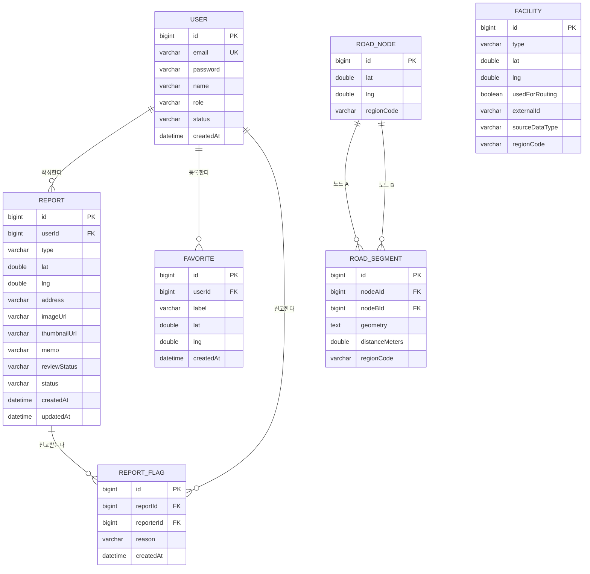

# SAFENAVI (컴퓨터공학종합설계2 개인 졸업작품)

### 목차

- **요구분석**
  - [프로젝트 소개](#프로젝트-소개)
  - [프로젝트 목적](#프로젝트-목적)
  - [문제 정의](#문제-정의)
  - [예상 사용자](#예상-사용자)
  - [기능 요구사항](#기능-요구사항)
  - [비기능 요구사항](#비기능-요구사항)
  - [유스케이스](#유스케이스)
- **설계**
  - [시스템 아키텍처](#시스템-아키텍처)
  - [핵심 알고리즘](#핵심-알고리즘)
  - [데이터베이스 설계(ERD)](#데이터베이스-설계-ERD)
  - [데이터베이스 명세서](#데이터베이스-명세서)
  - [API 설계](#API-설계)
- **구현**
  - [프론트엔드](#프론트엔드)
  - [백엔드](#백엔드)
  - [데이터베이스](#데이터베이스)
- **테스트**
  - [테스트 전략](#테스트-전략)
  - [테스트 케이스](#테스트-케이스)
- [설치 및 실행](#설치-및-실행)
- [향후 개선 사항](#향후-개선-사항)
- [결론](#결론)

<br>

---

## 프로젝트 소개

**SAFENAVI**는 CCTV·보안등·지구대파출소·안심지킴이집·응급의료기관 등 공공데이터를 기반으로, 출발지에서 목적지까지 더 안전한 보행 경로를 추천하는 모바일 앱입니다.

사용자는 지도에서 목적지를 탭하는 것만으로 프리셋별(기본안전경로/CCTV 위주/가로등 위주/공공안전시설 위주/안심지킴이집 위주) 경로를 비교해볼 수 있고, 실제로 겪은 위험요소(조명부족, 시야가림 등)를 제보해 공공데이터가 놓친 빈틈을 커뮤니티가 보완합니다.

<br>

---

## 프로젝트 목적

- **개인화된 안전 기준 반영** — 프리셋 선택에 따라 서로 다른 경로를 제공해, "안전"의 기준이 사람마다 다르다는 점을 반영한다.
- **커뮤니티 제보를 통한 위험정보 보완** — 공공데이터가 놓치는 실제 위험요소(조명부족, 시야가림 등)를 시민 제보로 메운다.
- **신뢰성과 역할의 분리** — 경로 탐색은 검증된 공공데이터를 기준으로 하고, 제보는 참고 정보로만 노출해 두 데이터의 신뢰 수준을 명확히 분리한다.

<br>

---

## 문제 정의

| 문제 | 내용 |
|------|------|
| **최단거리 중심 내비게이션** | 기존 지도 앱은 "가장 빠른 길"만 안내할 뿐, 보행자가 느끼는 안전도(조명, CCTV, 치안시설 접근성)는 고려하지 않음 |
| **공공데이터의 파편화** | CCTV·보안등·안심지킴이집 등 안전 관련 공공데이터가 각각 다른 포털에 흩어져 있어, 일반 사용자가 직접 종합해서 판단하기 어려움 |
| **획일적인 안전 기준** | "안전한 길"의 기준은 CCTV를 중시하는 사람, 가로등을 중시하는 사람 등 제각각인데 기존 서비스는 이를 구분하지 않음 |
| **실시간 위험정보 공백** | 공공데이터는 갱신 주기가 길어, 최근 발생한 위험요소(가로등 고장, 시야 가리는 공사 등)를 반영하지 못함 |

<br>

---

### 예상 사용자

| 유형 | 설명 |
|------|------|
| **보행 안전 민감 사용자** | 늦은 시간 귀가·등하교가 잦아 보행 경로의 안전성을 우선순위로 두는 사용자 |
| **지역 커뮤니티 제보자** | 거주 지역의 위험요소(조명부족, 시야가림 등)를 공유하고 다른 보행자에게 알리고 싶은 사용자 |
| **공공데이터 참고 이용자** | 특정 안전 기준(CCTV, 치안시설 등)에 따라 경로를 직접 비교해보고 싶은 사용자 |

<br>

---

## 기능 요구사항

### 인증
- 이메일/비밀번호 기반 회원가입·로그인 (BCrypt 해시, JWT 토큰)
- Access Token(30분) / Refresh Token(2주) 이원화, 토큰 재발급
- 로그인 없이 경로 탐색·지도 조회·제보 조회 가능 (읽기 전용)

### 경로 탐색
- 목적지 확정 시 5개 프리셋(기본안전경로/CCTV 위주/가로등 위주/공공안전시설 위주/안심지킴이집 위주) 소요시간 자동 비교
- 프리셋 선택 시 해당 경로의 polyline을 지도에 표시
- 다익스트라 기반 최단/최적 경로 탐색 (직접 구현, 외부 그래프 라이브러리 미사용)

### 지도 기능
- OpenStreetMap 타일 기반 전체화면 지도
- CCTV·보안등·지구대파출소·안심지킴이집·응급의료기관 위치 마커 표시
- 제보 위치 마커(사진 썸네일, 미처리 상태 표시) 및 상세 확인
- 특정 좌표의 안전점수 조회

### 즐겨찾기
- 자주 가는 목적지 등록·조회·삭제 (집/학교 등 라벨 지정)

### 커뮤니티 제보
- 위험요소 제보 등록 (유형: 조명부족/시야가림/기타, 사진 첨부, 위치 자동 감지)
- 본인 제보 수정·삭제, 허위 제보 신고
- 제보 상태(접수됨/검토중/반영됨) 확인

### 관리자
- 신고 누적 제보 검토 및 소프트 삭제 처리
- 사용자 계정 상태(활성/정지) 관리
- 공공데이터 수동 동기화, 도로망 그래프 수동 재구축 트리거

### 실시간 알림
- 제보 등록 시 해당 지역 구독자에게 WebSocket(STOMP)으로 실시간 알림

<br>

---

## 비기능 요구사항

| 항목	| 설명 |
|----|-----|
|성능 | 일반 API는 평균 2초 이내, 경로 탐색은 3초 이내 응답 |
|보안 |	비밀번호는 BCrypt 해시 저장, 인증은 JWT(Access/Refresh 이원화) 기반 |
|확장성	| 전국 서비스를 전제로 지역코드(regionCode) 기준 파티셔닝·병렬 배치가 가능한 구조로 설계 |
|가용성 | 공공데이터 API 중 일부가 장애여도 나머지 데이터 동기화는 계속 진행 |
|호환성	| iOS·Android 양쪽에서 동작하는 React Native(Expo) 앱으로 구현 |

<br>

---

## 유스케이스

| 액터 | 주요 유스케이스 |
|------|----------------|
| 비로그인 사용자 | 경로 탐색, 프리셋 비교, 지도·제보 조회 |
| 로그인 사용자 | 위 기능 + 제보 등록/수정/삭제, 허위 제보 신고, 즐겨찾기 관리, 실시간 알림 수신 |
| 관리자 | 신고된 제보 검토·처리, 사용자 계정 관리, 공공데이터/그래프 수동 동기화 |

<br>

---

## 시스템 아키텍처

```
[React Native(Expo) 앱]
        │  REST API / WebSocket(STOMP)
        ▼
[Spring Boot 백엔드 (EC2, Docker)]
        │
        ├─ MySQL 8.0 (AWS RDS) — User/RoadNode/RoadSegment/Facility/Report/ReportFlag/Favorite
        ├─ Redis — 캐싱 (향후 로그아웃 블랙리스트 등)
        ├─ AWS S3 — 제보 사진 저장
        ├─ OpenStreetMap 타일 — 지도 렌더링
        └─ 외부 연동
             ├─ 공공데이터포털 API 5종 (CCTV·보안등·안심지킴이집·지구대파출소·응급의료기관) — 매일 새벽 3시 스케줄러
             ├─ OSM Nominatim — 역지오코딩
             └─ OSM .pbf + 시군구 경계 Shapefile — 그래프 구축(graphbuild, 1회성 배치)
```

Cloudflare를 통해 HTTPS로 서비스하며, GitHub Actions + CodeDeploy로 CI/CD를 구성합니다.

<br>

---

## 핵심 알고리즘

출발지~목적지 bbox 안의 도로망·공공시설 데이터만 그때그때 불러와 계산하는 **요청 시점 계산 방식**입니다.

```
edge_cost = base_distance × (1 + α × danger_penalty)
danger_penalty = 1 - Σ(weight_i × safety_score_i) / Σ(weight_i)
```

| 프리셋 | 반영 시설 | 가중치 |
|---|---|---|
| CCTV 위주 | cctv | 단일 |
| 가로등 위주 | streetlight | 단일 |
| 안심지킴이집 위주 | guardianHouse | 단일 |
| 공공안전시설 위주 | police + emergencyMedical | 50 : 50 |
| 기본안전경로 | streetlight + cctv + publicSafety + guardianHouse | 각 25% |

1. `BoundingBoxCalculator` — 출발지·목적지를 감싸는 bbox 계산
2. `SubgraphProvider` — bbox 범위의 RoadNode/RoadSegment만 조회해 서브그래프 구성
3. `FacilityRepository` — bbox 안의 공공시설을 1회만 조회해 전체 프리셋이 공유
4. `EdgeCostCalculator` — 프리셋별 가중치로 구간마다 비용 계산
5. `DijkstraRouter` — 직접 구현한 다익스트라로 최단 경로 탐색

<br>

---

## 데이터베이스 설계 ERD



<br>

---

## 데이터베이스 명세서

### User 테이블

```sql
id BIGINT PK, email VARCHAR(255) UNIQUE, password VARCHAR(255),
name VARCHAR(50), role VARCHAR(20) DEFAULT 'USER', status VARCHAR(20) DEFAULT 'ACTIVE',
createdAt DATETIME
```

| 컬럼 | 타입 | NULL | KEY | 기본값 | 설명 |
|------|------|------|-----|--------|------|
| id | BIGINT | NOT NULL | PK | AUTO_INCREMENT | 사용자 고유 ID |
| email | VARCHAR(255) | NOT NULL | UNIQUE | - | 로그인 이메일 |
| password | VARCHAR(255) | NOT NULL | - | - | BCrypt 해시 |
| name | VARCHAR(50) | NOT NULL | - | - | 이름 |
| role | VARCHAR(20) | NOT NULL | - | USER | USER \| ADMIN |
| status | VARCHAR(20) | NOT NULL | - | ACTIVE | ACTIVE \| SUSPENDED |
| createdAt | DATETIME | NOT NULL | - | CURRENT_TIMESTAMP | 가입 시각 |

### RoadNode 테이블

| 컬럼 | 타입 | NULL | KEY | 설명 |
|------|------|------|-----|------|
| id | BIGINT | NOT NULL | PK | 교차로 식별자 |
| lat / lng | DOUBLE | NOT NULL | - | 좌표 |
| regionCode | VARCHAR(10) | NOT NULL | - | 시군구 코드 (파티셔닝 기준) |

### RoadSegment 테이블

| 컬럼 | 타입 | NULL | KEY | 설명 |
|------|------|------|-----|------|
| id | BIGINT | NOT NULL | PK | 간선 식별자 |
| nodeAId / nodeBId | BIGINT | NOT NULL | FK (→ RoadNode) | 양 끝점 (무방향 그래프, 방향 의미 없음) |
| geometry | TEXT | NOT NULL | - | 폴리라인 좌표열 |
| distanceMeters | DOUBLE | NOT NULL | - | 기본 거리(m) |
| regionCode | VARCHAR(10) | NOT NULL | - | 시군구 코드 |

### Facility 테이블

| 컬럼 | 타입 | NULL | KEY | 설명 |
|------|------|------|-----|------|
| id | BIGINT | NOT NULL | PK | 시설 식별자 |
| type | VARCHAR(30) | NOT NULL | - | cctv\|streetlight\|police\|guardianHouse\|emergencyMedical |
| lat / lng | DOUBLE | NOT NULL | - | 좌표 |
| usedForRouting | BOOLEAN | NOT NULL | - | 경로 가중치 반영 여부 (기본 true) |
| externalId | VARCHAR(100) | NULL | UNIQUE | 공공데이터 원본 식별자 (중복 수집 방지) |
| sourceDataType | VARCHAR(30) | NOT NULL | - | 데이터 출처 종류 |
| regionCode | VARCHAR(10) | NOT NULL | - | 시군구 코드 |

### Report 테이블

| 컬럼 | 타입 | NULL | KEY | 설명 |
|------|------|------|-----|------|
| id | BIGINT | NOT NULL | PK | 제보 식별자 |
| userId | BIGINT | NOT NULL | FK (→ User) | 작성자 |
| type | VARCHAR(20) | NOT NULL | - | 조명부족\|시야가림\|기타 |
| lat / lng | DOUBLE | NOT NULL | - | 제보 위치 |
| address | VARCHAR(255) | NULL | - | 역지오코딩 주소 |
| imageUrl / thumbnailUrl | VARCHAR(500) | NULL | - | 원본/축소 이미지(S3) |
| memo | VARCHAR(500) | NULL | - | 메모 |
| reviewStatus | VARCHAR(20) | NOT NULL | - | 접수됨\|검토중\|반영됨 |
| status | VARCHAR(20) | NOT NULL | - | ACTIVE\|REMOVED (관리자 소프트 삭제) |
| createdAt / updatedAt | DATETIME | - | - | 등록/수정 시각 |

### ReportFlag 테이블

| 컬럼 | 타입 | NULL | KEY | 설명 |
|------|------|------|-----|------|
| id | BIGINT | NOT NULL | PK | 신고 식별자 |
| reportId | BIGINT | NOT NULL | FK (→ Report) | 신고 대상 제보 |
| reporterId | BIGINT | NOT NULL | FK (→ User) | 신고자 |
| reason | VARCHAR(255) | NOT NULL | - | 신고 사유 |
| createdAt | DATETIME | NOT NULL | - | 신고 시각 |

### Favorite 테이블

| 컬럼 | 타입 | NULL | KEY | 설명 |
|------|------|------|-----|------|
| id | BIGINT | NOT NULL | PK | 즐겨찾기 식별자 |
| userId | BIGINT | NOT NULL | FK (→ User) | 소유자 |
| label | VARCHAR(50) | NOT NULL | - | 집/학교 등 지정 이름 |
| lat / lng | DOUBLE | NOT NULL | - | 좌표 |
| createdAt | DATETIME | NOT NULL | - | 등록 시각 |

<br>

---

## API 설계

```
Authorization: Bearer <JWT_TOKEN>
```

Base URL: `https://api.safenavi.app/api` — 모든 응답은 `{ success, data, error }` 공통 래퍼를 사용합니다.

---

### Auth API

#### 회원가입
```
POST /api/auth/signup
```
**Request Body**
```json
{ "email": "user@example.com", "password": "Pa$$w0rd!", "name": "고영민" }
```
**Response 201**
```json
{ "success": true, "data": { "userId": 101, "email": "user@example.com", "name": "고영민" }, "error": null }
```

---

#### 로그인
```
POST /api/auth/login
```
**Response 200**
```json
{ "success": true, "data": { "accessToken": "...", "refreshToken": "..." }, "error": null }
```

---

#### 토큰 재발급
```
POST /api/auth/token/refresh
```

#### 로그아웃
```
POST /api/auth/logout
```

---

### Users API

#### 내 프로필 조회
```
GET /api/users/me
Authorization: Bearer <token>
```

---

### Geo API

#### 역지오코딩
```
GET /api/geo/reverse?lat=37.4979&lng=127.0276
```
**Response 200**
```json
{ "success": true, "data": { "dong": "서초동", "roadAddress": "서울 서초구 서초대로 12길" }, "error": null }
```

---

### Routes API

#### 프리셋 비교
```
GET /api/routes/compare?originLat=&originLng=&destLat=&destLng=
```
목적지가 확정되면 자동 호출됩니다. polyline은 포함하지 않습니다.

**Response 200**
```json
{
  "success": true,
  "data": [
    { "preset": "default", "distanceMeters": 980, "estimatedMinutes": 12, "safetyScore": 55 },
    { "preset": "cctv", "distanceMeters": 1180, "estimatedMinutes": 15, "safetyScore": 82 }
  ],
  "error": null
}
```

---

#### 단일 경로 탐색
```
GET /api/routes?originLat=&originLng=&destLat=&destLng=&preset=cctv
```
**Response 200**
```json
{
  "success": true,
  "data": {
    "preset": "cctv", "distanceMeters": 1180, "estimatedMinutes": 15,
    "safetyScore": 82, "polyline": [[37.4979, 127.0276], [37.4981, 127.0280]]
  },
  "error": null
}
```

---

### Safety API

#### 안전점수 조회
```
GET /api/safety-score?lat=&lng=&radius=300
```
**Response 200**
```json
{ "success": true, "data": { "safetyScore": 82, "cctvCount": 14, "streetlightCount": 22 }, "error": null }
```

---

### Favorites API

```
POST   /api/favorites            즐겨찾기 등록
GET    /api/favorites            내 즐겨찾기 목록
DELETE /api/favorites/{id}       즐겨찾기 삭제
```

---

### Facilities API

#### 지도 범위 내 공공시설 조회
```
GET /api/facilities?swLat=&swLng=&neLat=&neLng=&type=cctv
```
**Response 200**
```json
{
  "success": true,
  "data": [
    { "facilityId": 5501, "type": "cctv", "lat": 37.4979, "lng": 127.0276, "usedForRouting": true }
  ],
  "error": null
}
```

---

### Reports API

```
POST   /api/reports                      제보 등록 (multipart/form-data)
GET    /api/reports?swLat=&swLng=&...    bbox 내 제보 목록 (요약 정보만)
GET    /api/reports/{id}                 제보 상세 조회
GET    /api/reports/me                   본인 제보 이력
PATCH  /api/reports/{id}                 제보 수정 (본인만)
DELETE /api/reports/{id}                 제보 삭제 (본인만)
POST   /api/reports/{id}/flags           허위 제보 신고
```

**제보 등록 Request Body (multipart)**
```
type: "조명부족"
lat: 37.4979
lng: 127.0276
memo: "가로등이 꺼져있어서 밤에 어두워요"
image: (file)
```

---

### Admin API

```
GET   /api/admin/reports?status=flagged      신고 누적 제보 목록
PATCH /api/admin/reports/{id}/status         제보 상태 변경 (소프트 삭제)
GET   /api/admin/users                       사용자 목록
PATCH /api/admin/users/{id}/status           사용자 이용 제한
POST  /api/admin/public-data/sync            공공데이터 수동 동기화
POST  /api/admin/graph-build/run             도로망 그래프 수동 재구축
```

---

### Realtime (WebSocket)

```
CONNECT    /ws                         STOMP 연결
SUBSCRIBE  /topic/alerts/{regionId}    지역 단위 위험 알림 구독
```

<br>

---

## 프론트엔드

| 분류 | 기술 |
|------|------|
| 프레임워크 | React Native (Expo) |
| 언어 | TypeScript |
| 지도 | react-native-maps + OpenStreetMap 타일 |
| 인증 토큰 저장 | expo-secure-store (Keychain/Keystore) |
| 외부 API | OSM Nominatim (역지오코딩), Kakao Local API (향후 확장) |

---

## 백엔드

| 분류 | 기술 |
|------|------|
| 언어 | Java 17 |
| 프레임워크 | Spring Boot 4.1.1 |
| 빌드 도구 | Gradle (Groovy DSL) |
| 데이터베이스 | MySQL 8.0 (AWS RDS) |
| ORM | Spring Data JPA |
| 인증 | Spring Security + JWT, BCrypt |
| 실시간 통신 | Spring WebSocket (STOMP) |
| 외부 API 호출 | WebClient |
| OSM 파싱 | osm4j-core, osm4j-pbf |
| 공간 연산 | JTS (Java Topology Suite) |
| 대용량 컬렉션 | Eclipse Collections |
| 파일 저장 | AWS S3 SDK v2 |
| 배포 | Docker, EC2, GitHub Actions, CodeDeploy, Cloudflare |

---

## 데이터베이스

| 기술 | 설명 |
|------|------|
| MySQL 8.0 | 관계형 데이터베이스, AWS RDS로 운영 |

### 저장 데이터 설명

| 테이블 | 저장 데이터 |
|--------|------------|
| `User` | 회원 계정 정보 (이메일, 비밀번호 해시, 역할, 상태) |
| `RoadNode` | 도로망 그래프의 교차로 좌표 |
| `RoadSegment` | 교차로 사이 도로 구간(거리·폴리라인), 다익스트라 탐색 대상 |
| `Facility` | CCTV·보안등·지구대파출소·안심지킴이집·응급의료기관 좌표 |
| `Report` | 시민 제보(위험요소 유형, 위치, 사진, 처리 상태) |
| `ReportFlag` | 제보에 대한 허위 신고 이력 |
| `Favorite` | 사용자별 즐겨찾기 목적지 |

<br>

---

## 테스트 전략

백엔드 핵심 플로우(인증 → 공공데이터 수집 → 경로 탐색)가 실제로 동작하는지 Postman과 DB 조회로 확인하고, 이후 프론트엔드 연동 단계에서 화면 단위 기능 테스트를 추가할 예정입니다.

---

## 테스트 케이스

| 테스트 항목 | 입력 | 예상 결과 | 진행 상태 |
|------------|------|----------|----------|
| 회원가입 | 이메일, 비밀번호, 이름 입력 | BCrypt 해시로 User 저장, 201 응답 | 예정 |
| 중복 이메일 가입 | 이미 가입된 이메일 재입력 | 409 Conflict 응답 | 예정 |
| 로그인 | 가입한 이메일/비밀번호 입력 | accessToken/refreshToken 발급 | 예정 |
| 토큰 없이 인증 API 호출 | Authorization 헤더 미포함 | 401 Unauthorized | 예정 |
| 공공데이터 동기화 | 관리자 수동 동기화 트리거 | Facility 테이블에 레코드 upsert | 예정 |
| 프리셋 비교 조회 | 출발지·목적지 좌표 | 5개 프리셋 소요시간 목록 반환 | 예정 |
| 단일 경로 조회 | 좌표 + preset=cctv | polyline 포함 경로 반환 | 예정 |
| 제보 등록 | 유형, 좌표, 사진 첨부 | S3 업로드 후 Report 저장 | 예정 |
| 허위 제보 신고 | 타인 제보에 신고 사유 등록 | ReportFlag 저장 | 예정 |

<br>

---

## 설치 및 실행

### 사전 요구사항

- Java 17
- MySQL 8.0 (로컬은 Docker 권장)
- 공공데이터포털 API 인증키 5종
- OSM `.pbf` 파일, 전국 시군구 경계 Shapefile (그래프 구축용)

### 1. 저장소 클론

```bash
git clone https://github.com/<your-username>/safenavi-backend.git
cd safenavi-backend
```

### 2. 데이터베이스 설정 (Docker)

```bash
docker compose up -d
docker exec -i safenavi-mysql mysql -u root -p safenavi < SAFENAVI_schema.sql
```

### 3. 공공데이터 설정 파일 채우기

`src/main/resources/public-data.yml`에 5개 API의 End Point와 인증키를 입력합니다.

```yaml
safenavi:
  public-data:
    cctv:
      base-url: "https://apis.data.go.kr/1741000/cctv_info"
      service-key: "발급받은 인증키"
    # streetlight, guardian-house, police, emergency-medical 동일하게 입력
```

### 4. 도로망 그래프 구축 설정 파일 채우기

`src/main/resources/graph-build.yml`에 OSM 파일 경로와 경계 Shapefile 경로를 입력합니다.

```yaml
safenavi:
  graph-build:
    osm-pbf-path: "/path/to/south-korea-latest.osm.pbf"
    boundary-shapefile-path: "/path/to/sigungu-boundary.shp"
```

### 5. 백엔드 실행

```bash
./gradlew bootRun
```

### 6. 접속 확인

```
GET http://localhost:8080/api/facilities?swLat=...&swLng=...&neLat=...&neLng=...
```

<br>

---

## 향후 개선 사항

| 항목 | 설명 |
|------|------|
| **목적지 텍스트 검색** | Kakao Local API 연동으로 장소명 검색 지원 (현재는 지도 탭으로만 목적지 지정) |
| **로그아웃 즉시 무효화** | Redis 기반 토큰 블랙리스트 도입 |
| **공간 인덱스 전환** | lat/lng DOUBLE 컬럼을 POINT 타입 + SPATIAL INDEX로 마이그레이션해 bbox·반경 쿼리 성능 개선 |
| **전국 파티셔닝 고도화** | RoadNode/RoadSegment/Facility를 regionCode 기준으로 테이블 파티셔닝, 공공데이터 동기화를 지역별 병렬 배치로 전환 |
| **여성밤길치안안전 데이터 추가** | 생활안전지도 WMS 데이터 연동 검토 (위치기반서비스사업신고 요건 확인 필요) |
| **실시간 알림 고도화** | 사용자 위치 기반으로 반경 내 신규 위험요소를 자동 구독·알림 |

<br>

---

## 결론

SAFENAVI는 공공데이터와 커뮤니티 제보를 결합해 "안전"이라는 주관적 기준을 사용자가 직접 선택할 수 있게 만든 보행 경로 추천 서비스입니다.

Spring Boot 백엔드와 React Native 프론트엔드를 연동하고, MySQL로 도로망 그래프와 공공데이터를 관리하는 풀스택 구조를 설계했습니다. OpenStreetMap 데이터를 직접 파싱해 도로망 그래프를 구축하고, 다익스트라 알고리즘을 라이브러리 의존 없이 직접 구현하는 과정에서 알고리즘과 대용량 데이터 처리에 대한 실무적인 트레이드오프(지역 한정 사전 계산 vs 전국 규모 요청 시점 계산)를 깊이 있게 고민했습니다.

JWT 기반 인증, 공공데이터 API 다중 연동, 지리 공간 데이터 처리 등 백엔드 개발자로서 필요한 역량을 종합적으로 적용해본 프로젝트였습니다.
